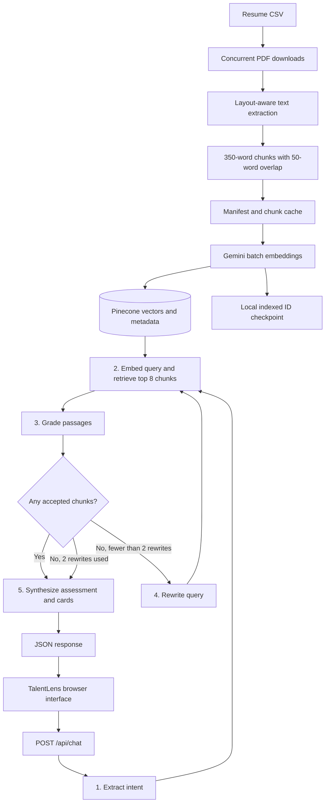

# TalentLens: Agentic Resume RAG

TalentLens is a full-stack resume search application. A recruiter describes the skills or experience they need, and the application searches indexed resume passages, evaluates their relevance, and returns candidate cards alongside a written assessment with resume links.

The backend also uses the name **Antigravity Agentic Resume RAG Copilot**. Both names refer to this project. This guide describes the actual code and distinguishes it from features proposed in the original plan.

## Contents

1. [Project overview and saved results](#1-project-overview-and-saved-results)
2. [Core concepts](#2-core-concepts)
3. [Architecture](#3-architecture)
4. [File-by-file guide](#4-file-by-file-guide)
5. [Ingestion, parsing, and chunking](#5-ingestion-parsing-and-chunking)
6. [Embeddings and vector indexing](#6-embeddings-and-vector-indexing)
7. [The five-node LangGraph workflow](#7-the-five-node-langgraph-workflow)
8. [Candidate scores and evidence](#8-candidate-scores-and-evidence)
9. [Backend API](#9-backend-api)
10. [Frontend behavior](#10-frontend-behavior)
11. [Configuration and local setup](#11-configuration-and-local-setup)
12. [Tracing and failure handling](#12-tracing-and-failure-handling)
13. [Deployment configuration](#13-deployment-configuration)
14. [Verification and troubleshooting](#14-verification-and-troubleshooting)
15. [Implementation boundaries and future work](#15-implementation-boundaries-and-future-work)
16. [Interview walkthrough](#16-interview-walkthrough)

## 1. Project overview and saved results

Example requests:

- "Find candidates with machine learning and mathematics experience."
- "Find backend engineers with Kubernetes or Spring Boot experience."
- "Find candidates experienced in Bayesian statistics or MCMC."
- "Compare candidates by their project impact."

There are two separate execution flows:

1. **Prepare the data:** read a CSV, download linked PDFs, extract text, split it into overlapping passages, generate embeddings, and upload vectors plus metadata to Pinecone.
2. **Answer a search:** interpret a recruiter request, retrieve similar passages, grade them, optionally rewrite and repeat the search, then generate an assessment and candidate cards.

The models are pretrained services called through APIs. There is no model training or fine-tuning in this repository. The browser does not upload resumes; ingestion reads a CSV from the backend filesystem.

### Evidence in the local workspace

The following snapshot was inspected on **13 November 2026**:

| Artifact | Observed state | Meaning |
| --- | --- | --- |
| `data/ingestion_manifest.json` | 3,230 processed records; 3,230 successful downloads and parses; zero recorded failures | The saved manifest reports a completed parsing run |
| `data/parsed_chunks.json` | 9,455 chunks across 3,230 candidate IDs | Parsed text and candidate metadata are available locally |
| `data/indexed_ids.json` | 4,855 unique IDs, all belonging to the chunk cache | The checkpoint records successful indexing for part of this cache |
| IDs absent from the checkpoint | 4,600 | These chunks would be pending according to the local checkpoint |
| Source CSV and raw PDFs | CSV absent; no PDFs in `data/raw_resumes/` | A new download/parse run needs the CSV; cached chunks can still be indexed |
| `data/* - Copy.json` | Identical to their corresponding canonical JSON files | Backup files; runtime code does not read them |

**These counts do not verify the live Pinecone index.** The checkpoint is a local record, not a remote inventory. Candidate IDs represent CSV rows, so the count does not establish the number of distinct people if the input contains multiple resumes per person.

## 2. Core concepts

| Concept | Meaning | Use in this project |
| --- | --- | --- |
| Retrieval-augmented generation (RAG) | Retrieve source material before generating an answer | Pinecone passages become context for Groq prompts |
| Dense embedding | Represent text as a numerical vector so meanings can be compared | Gemini embeds resume chunks and search queries |
| Semantic search | Find related meanings even when wording differs | Pinecone cosine similarity search |
| Chunking | Split a document into smaller searchable passages | 350-word windows with 50-word overlap |
| Context injection | Attach source identity to a passage before embedding | Candidate ID, name, and URL header on every chunk |
| Metadata | Store useful fields alongside a vector | Candidate identity, contact details, URL, and passage text |
| Upsert | Insert a record or replace an existing record with the same ID | Pinecone IDs such as `cand_0001_0` |
| Checkpointing | Record completed work so it can be skipped on restart | Local `indexed_ids.json` |
| Structured LLM output | Ask a model for machine-readable JSON | Extraction, grading, and rewriting use JSON mode |
| Stateful graph | Carry intermediate results between processing steps | `AgentState` passed through LangGraph nodes |
| Conditional routing | Choose the next step based on current results | Rewrite when grading accepts no passages |
| Query expansion | Add synonyms or broaden terms for another search | The rewrite node changes the semantic query |
| Synthesis | Turn selected evidence into a readable response | Groq writes Markdown; Python separately builds cards |
| Observability | Record execution so behavior can be inspected | LangSmith decorators and session metadata |

**Why Gemini and Groq?** Gemini supplies the numerical representation for retrieval. Groq serves the language model used to interpret requests, evaluate passages, rewrite queries, and write assessments. Pinecone stores/searches vectors; LangGraph controls execution.

**What makes this agentic?** A basic RAG chain can retrieve once and immediately answer. This graph evaluates results and can modify the query before trying again. It is one workflow with five specialized node functions, rather than five independent agents running in parallel.

**Why retrieve instead of sending all resumes to the model?** Retrieval limits prompt size and focuses generation on a smaller set of passages. Its tradeoff is that missing or truncated evidence can exclude a suitable candidate. Grounding an answer in retrieved material reduces reliance on model memory, but does not guarantee factual correctness.

## 3. Architecture



Ingestion happens before search, or through a separate ingestion request. A normal search does not download PDFs or load the complete local chunk cache; it reads the remote vector store.

For "Find Go backend engineers with Kubernetes experience":

1. The browser sends the query and a session ID to FastAPI.
2. The extractor might produce `Golang backend Kubernetes distributed systems` as search text. This is an illustrative output, not a recorded response.
3. Gemini embeds it, and Pinecone retrieves up to eight similar **chunks**, potentially from fewer than eight candidates.
4. Groq grades excerpts against the unchanged original request.
5. If no chunks pass, the graph can rewrite the query and repeat retrieval twice.
6. The synthesizer groups passages by candidate ID and produces an assessment and cards.
7. The browser renders the result after the complete request returns.

## 4. File-by-file guide

| File or directory | Responsibility |
| --- | --- |
| [`src/config.py`](src/config.py) | Loads root `.env`, defines paths/settings, creates runtime directories |
| [`src/ingest_resumes.py`](src/ingest_resumes.py) | Reads CSV, downloads PDFs, invokes parsing/chunking, writes manifest and chunk cache |
| [`src/pdf_parser.py`](src/pdf_parser.py) | Cleans text, orders PDF blocks, creates overlapping chunks with identity headers |
| [`src/embedding_store.py`](src/embedding_store.py) | Initializes Gemini/Pinecone, creates index, embeds/upserts, checkpoints, retrieves matches |
| [`src/agent_graph.py`](src/agent_graph.py) | Graph state, five nodes, prompts, routing, tracing, and `run_agent_query()` |
| [`src/main.py`](src/main.py) | FastAPI models, CORS, chat/ingestion/health endpoints, development server |
| [`requirements.txt`](requirements.txt) | Python dependency lower bounds; not an exact lockfile |
| [`.env.example`](.env.example) | Placeholder backend configuration; actual `.env` holds local credentials |
| [`.gitignore`](.gitignore) | Excludes credentials, dependencies, CSV, raw PDFs, and several generated artifacts |
| `data/raw_resumes/` | PDF download cache; empty in the inspected workspace |
| `data/ingestion_manifest.json` | Aggregate counters and per-record status/errors |
| `data/parsed_chunks.json` | Chunk text and candidate metadata for indexing |
| `data/indexed_ids.json` | Local completed vector IDs; currently tracked by Git |
| `data/* - Copy.json` | Backup artifacts; unused by runtime code and not all excluded by Git rules |
| `vectorstore/` | Created by configuration; unused by the actual remote-vector-store implementation |
| [`frontend/src/app/page.tsx`](frontend/src/app/page.tsx) | Page composition, backend URL, and health status |
| [`frontend/src/app/layout.tsx`](frontend/src/app/layout.tsx) | HTML layout and TalentLens page metadata |
| [`frontend/src/app/globals.css`](frontend/src/app/globals.css) | Responsive layout, Markdown styling, animations, and reduced-motion support |
| [`frontend/src/components/ChatInterface.tsx`](frontend/src/components/ChatInterface.tsx) | Requests, temporary history, loading/errors, Markdown brief, candidate detail drawer |
| [`frontend/src/components/CandidateCard.tsx`](frontend/src/components/CandidateCard.tsx) | Typed card interface, scores, skills, contact details, and source links |
| [`frontend/src/components/ColdStartBanner.tsx`](frontend/src/components/ColdStartBanner.tsx) | Health polling and warming-up notice |
| [`frontend/package.json`](frontend/package.json), [`frontend/package-lock.json`](frontend/package-lock.json) | Scripts, declared dependencies, and resolved versions |
| [`frontend/tsconfig.json`](frontend/tsconfig.json) | Strict TypeScript configuration and `@/*` source alias |
| [`frontend/eslint.config.mjs`](frontend/eslint.config.mjs) | Next.js and TypeScript lint rules |
| [`frontend/postcss.config.mjs`](frontend/postcss.config.mjs) | Tailwind CSS PostCSS plugin |
| [`frontend/next.config.ts`](frontend/next.config.ts) | Default Next.js configuration with no custom options |
| [`frontend/.gitignore`](frontend/.gitignore) | Frontend dependencies, builds, environment files, and local hosting artifacts excluded from Git |
| `frontend/public/*.svg`, `frontend/src/app/favicon.ico` | Static assets; public SVGs are framework starter assets |
| [`frontend/README.md`](frontend/README.md) | Original framework starter guide; this root README describes the project |
| `frontend/AGENTS.md`, `frontend/CLAUDE.md` | Coding-assistant guidance; not runtime application logic |
| `.vscode/settings*.json` | Editor preference for Python terminal environment-file loading |
| `Plan_of_Action_Agentic_Resume_RAG_Antigravity.pdf` | Original proposal; some planned features differ from implementation |
| [`resume_bullet_points.md`](resume_bullet_points.md), [`story_resume_bullet_points.md`](story_resume_bullet_points.md), `resume rag resume points.png` | Resume narratives; verify their claims against the actual code |

## 5. Ingestion, parsing, and chunking

### CSV schema and identity

`run_ingestion_pipeline()` uses `pandas.read_csv()` on this root-level filename:

```text
Resume Dashboard - Placement 2025-26 Phase 1.csv
```

| Column | Use |
| --- | --- |
| `Resume ID` | Source record identifier and part of the downloaded filename |
| `Student Name` | Display name and chunk header |
| `Student Email` | Contact metadata |
| `Student Roll No` | Candidate record metadata |
| `Resume Type` | Manifest/chunk-cache field; not uploaded as vector metadata |
| `Resume Link` | Download URL and source link shown to users |

IDs are generated from dataframe row indices: `cand_0001`, `cand_0002`, etc. Filenames follow `cand_0001_<Resume ID>.pdf`. Reordering rows changes identity; IDs are not content hashes or permanent person IDs. Non-HTTP/invalid links are skipped before manifest creation, so the manifest count can be lower than the CSV row count.

### Concurrent downloading

`aiohttp` and `asyncio` download files concurrently, while a semaphore limits active requests. The function and API default to **20** concurrent downloads; the CLI explicitly uses **25**. The HTTP connector allows `concurrency + 10` connections and caches DNS for 300 seconds.

Each download has a **45-second timeout** and up to **three attempts**. Existing files larger than **1,024 bytes** are reused. A successful HTTP response with fewer than **500 bytes** is rejected. The downloader does not validate PDF signatures or MIME type; parsing may catch a downloaded HTML/error page later.

Exceptions before the final attempt sleep for `0.5 * 2**attempt` seconds. Non-200 HTTP responses can retry without that delay. After all downloads finish, PDF parsing runs **sequentially**. Asynchronous downloading does not imply parallel parsing or fully asynchronous indexing.

### Layout-aware PDF extraction

`extract_pdf_layout_aware()` uses PyMuPDF's `page.get_text("blocks")`, which provides text and bounding-box coordinates. Image blocks are excluded.

Single-column pages are ordered top-to-bottom and then left-to-right. For a presumed two-column page, the parser:

1. Looks for at least two blocks on each side of the midpoint, with 40-unit tolerances.
2. Classifies blocks into left, right, or spanning groups using 20-unit tolerances.
3. Sorts each group by vertical then horizontal position.
4. Concatenates spanning blocks first, then left-column text, then right-column text.

This reduces column interleaving but remains a heuristic. Spanning footers can move ahead of column text, and unusual layouts can be misordered. There is no OCR, dedicated table parser, or semantic section detector.

`clean_text()` normalizes line endings, non-breaking spaces, spaces, and tabs, and removes blank lines. Extraction shorter than **50 characters after stripping surrounding whitespace** is treated as a parse failure.

### Chunking and identity preservation

`chunk_resume_with_context()` splits text on whitespace and takes **350-word windows**, advancing **300 words** each time. Adjacent full chunks overlap by **50 words**. These are words, despite references to tokens in an older docstring and the plan.

For an 800-word resume:

```text
Chunk 0: words   1-350
Chunk 1: words 301-650
Chunk 2: words 601-800
```

Overlap helps preserve project/skill descriptions that cross a boundary. Smaller chunks focus retrieval but can lose context; larger chunks retain context but mix topics. The current algorithm uses fixed windows, not sentence-aware or semantic boundaries.

Each chunk has two text representations:

```text
text:     [Candidate ID: cand_0001 | Name: Example Candidate | URL: https://example.com/resume.pdf]
          <chunk body>

raw_text: <chunk body only>
```

The header-enriched `text` is embedded. The body-only `raw_text` is stored as Pinecone `chunk_text` for grading and synthesis. Explicit metadata provides the programmatic identity/source association; the header alone cannot guarantee identity preservation in vector space. `word_count` counts the body only.

### Generated artifacts

The manifest records counters and each candidate's metadata, local path, byte size, chunk count, errors, and status: `SUCCESS`, `PARSE_ERROR`, or `DOWNLOAD_FAILED`.

The chunk cache contains `candidate_id`, `chunk_index`, `name`, `resume_url`, `text`, `raw_text`, `word_count`, `email`, `roll_no`, `resume_type`, and `raw_resume_id`.

**Every ingestion run overwrites the manifest and chunk cache.** A 50-row run after a full run replaces the local output with the smaller dataset. It does not delete previous Pinecone vectors.

## 6. Embeddings and vector indexing

### Model, dimensions, and similarity

The code uses **`gemini-embedding-001`**. A new Pinecone Serverless index uses **1,024 dimensions**, **cosine** similarity, and **AWS `us-east-1`**. Its default name is `resume-rag`.

```text
cosine_similarity(query, chunk) = dot(query, chunk) / (norm(query) * norm(chunk))
```

Cosine similarity compares vector direction. A higher value means greater embedding similarity; it is not a probability of candidate suitability.

`ensure_index()` creates a missing index and waits until ready. For an existing index, `get_index_dimension()` reads/caches the dimension and requests that dimensionality from Gemini. Existing vectors must also use a compatible embedding model: matching dimensions alone is insufficient. The existing index's metric is not validated or changed.

Documents and queries use the same model and requested dimension. No separate embedding task type, local normalization, sparse retrieval, or keyword/vector hybrid search is configured.

### Indexing algorithm

`index_parsed_chunks()` reads `data/parsed_chunks.json` unless chunks are passed directly:

1. Ensure the index exists and determine its dimension.
2. Load `data/indexed_ids.json` as a set of completed IDs.
3. Select chunks absent from the checkpoint.
4. Embed them in batches of **30**.
5. Upsert vectors with IDs such as `cand_0001_0` and metadata.
6. Save the checkpoint after each successful upsert.
7. Sleep **4 seconds** after each successful batch, including the final one.

Pinecone metadata contains `candidate_id`, `raw_resume_id`, `name`, `email`, `roll_no`, `resume_url`, `chunk_index`, and `chunk_text`. PDF bytes are not uploaded to Pinecone by this code.

### Retries and checkpoints

Batch embedding uses Tenacity: up to **10 attempts**, with exponential waits bounded between **5 and 60 seconds**. Errors containing `429` or `RESOURCE_EXHAUSTED` add a **15-second** sleep. The log message says 30 seconds, but the actual sleep is 15.

Checkpointing supports restarting an interrupted run with unchanged data/index configuration, but has limitations:

- It is not associated with an index name, account, model, dimension, or content hash.
- Switching to an empty index while retaining the checkpoint can skip necessary uploads.
- Changed content with an already checkpointed ID is also skipped.
- Row reordering can reuse candidate IDs for different people.
- Old resumes and obsolete extra chunks are not automatically deleted from Pinecone.
- Multiple indexers share the same checkpoint file without locking.

For a clean rebuild, use a dedicated empty index and archive/move the old checkpoint before indexing the intended cache. Keep the source data, selected index, and checkpoint consistent. A local "already indexed" message does not verify the remote database.

### Retrieval helper

`query_pinecone_store()` embeds one query and requests matches with metadata. The helper defaults to `top_k=5`; the graph overrides it to **8**. It accepts `filter_dict`, but the graph does not provide one. There is no vector-score threshold.

Query embeddings and Pinecone operations do not use the batch embedding retry decorator. Query-time provider failures can propagate directly to the chat endpoint.

## 7. The five-node LangGraph workflow

[`src/agent_graph.py`](src/agent_graph.py) compiles one `agent_app` graph. Each `run_agent_query()` invocation creates fresh state.

### State fields

| Field | Purpose |
| --- | --- |
| `query` | Incoming request |
| `original_query` | Unchanged request used for grading and synthesis |
| `semantic_query` | Current search text, editable by extraction/rewriting |
| `extracted_filters` | Extractor JSON; currently not enforced as metadata filters |
| `retrieved_docs` | Matches from the latest search |
| `graded_docs` | Accepted matches from the latest grading pass |
| `rewrite_count` | Completed rewrite attempts |
| `final_response` | Generated Markdown |
| `candidate_cards` | Structured results for the frontend |

There is no persistent graph checkpointer or conversation memory. Each retrieval/grading attempt replaces its preceding results; earlier attempts are not accumulated.

### Node 1: Extract and route

Groq is prompted to return JSON like this illustrative example:

```json
{
  "is_search_query": true,
  "semantic_query": "Golang backend Kubernetes distributed systems",
  "skills": ["Go", "Kubernetes"],
  "role_target": "Backend engineer",
  "experience_level": "entry"
}
```

Temperature is **0.1**. If the call or parsing fails, the original query becomes the search text.

Despite the name, every request proceeds to retrieval: `is_search_query` does not select another route. Extracted skills, role, and experience are stored but not converted into mandatory Pinecone filters. They may influence semantic text, but hard constraints are not programmatically enforced.

### Node 2: Retrieve

Embed `semantic_query` and retrieve the **top eight chunks** with IDs, similarity scores, and metadata. Several chunks can belong to the same candidate. The retrieval result is not necessarily eight distinct profiles or the globally strongest applicants.

### Node 3: Grade documents

One Groq call grades all retrieved chunks against `original_query`, using only the **first 600 characters** of each stored chunk body. Temperature is **0.0**.

The expected JSON has an `evaluations` list with `candidate_index`, `is_relevant`, `relevance_score`, `matched_skills`, and `reason`. Despite the field name, `candidate_index` refers to a retrieved chunk's position in the prompt.

The implemented acceptance rule is:

```python
is_relevant or relevance_score >= 40
```

A chunk marked irrelevant can pass if its score is at least 40. Missing `is_relevant` defaults to `True`. If grading/parsing raises an exception, **all retrieved documents are retained**.

JSON mode requests valid JSON syntax; it does not fully validate this internal schema or ensure factual correctness. Pydantic validation is applied later at the API boundary.

### Conditional routing and Node 4: Rewrite

```text
At least one accepted chunk -> synthesize
Zero accepted chunks and fewer than 2 rewrites -> rewrite, retrieve, grade again
Zero accepted chunks and 2 rewrites already used -> synthesize anyway
```

The rewriter asks for technical synonyms and broader search wording while preserving the core goal. It returns `rewritten_query` in JSON at temperature **0.3**. On failure, the query remains unchanged, but `rewrite_count` still increases.

There are at most **three retrieval rounds**: the first search and two retries. A single accepted chunk stops rewriting. Extraction is not repeated in the loop, and grading still uses the original request.

### Node 5: Synthesize

The node groups passages by `candidate_id`, combines their text, and includes at most **1,000 characters per candidate** in the synthesis prompt. Candidate ID, name, email, and source URL are supplied separately. Groq is asked for Markdown containing fit discussion, skills, projects, resume links, and a comparison matrix where appropriate. Temperature is **0.2**.

If grading remains empty, this node falls back to the latest retrieved chunks. Thus, rejected passages can still be used after retries. If retrieval is empty too, the model is called with empty candidate context; there is no deterministic no-evidence response.

All LLM roles use **one configured model**, `GROQ_MODEL`, defaulting to `openai/gpt-oss-120b`. There is no automatic second-model fallback.

A successful first-pass search with retrieved passages normally makes **three Groq calls**: extraction, grading, and synthesis. Two full rewrite cycles can increase this to **seven Groq calls**, three query embeddings, and three Pinecone searches. Empty retrieval skips the grader call for that round.

## 8. Candidate scores and evidence

The response has two independently constructed parts:

- **Written assessment:** Groq generates free-form Markdown from the supplied context.
- **Candidate cards:** Python builds objects from retrieved metadata and grading results.

For each candidate, the first retained chunk supplies the evaluation and similarity score. Other chunks add text, but their skill lists and scores are not aggregated. The card score uses the grader's `relevance_score` when available; otherwise it uses `int(first_chunk_similarity_score * 100)`.

There is no explicit sort by grader score in the backend or frontend. Candidate cards preserve first-seen candidate order in retained documents, which can depend on the grader's output order. UI "Rank" numbers are list positions, not a separately calculated global ranking.

The frontend clamps displayed scores to 0-100 and labels them "confidence." These are heuristic relevance signals, not calibrated probabilities. The model may independently write a suitability score in Markdown, so it can differ from the card score.

Resume URLs come from source metadata. Although the synthesis prompt requests the label "View Verified Resume," the code does not independently verify links at answer time or validate quoted/page-level citations. Context truncation and permissive fallbacks can produce incomplete or unsupported assessments.

## 9. Backend API

FastAPI and Pydantic define the API in [`src/main.py`](src/main.py). Interactive documentation is at `/docs` when running.

| Method and path | Behavior |
| --- | --- |
| `GET /` | Service status/name and documentation/health paths |
| `GET /healthz` | Static healthy response, configured index name, engine description |
| `POST /api/chat` | Execute the graph and return assessment/cards |
| `POST /api/ingest` | Schedule ingestion followed by indexing in a background task |

### Chat

Request:

```json
{
  "query": "Find candidates with Python and machine learning projects",
  "session_id": "demo-session"
}
```

The session ID is optional; the backend generates a UUID if absent or empty. Query whitespace is stripped. Empty/whitespace-only queries return HTTP **400**; invalid bodies are handled by FastAPI request validation. Unhandled workflow exceptions return HTTP **500**.

Illustrative response with fictional data:

```json
{
  "session_id": "demo-session",
  "query": "Find candidates with Python and machine learning projects",
  "response": "## Candidate assessment\nExample Candidate has relevant project evidence...",
  "candidate_cards": [
    {
      "candidate_id": "cand_0001",
      "name": "Example Candidate",
      "email": "candidate@example.com",
      "roll_no": "EXAMPLE001",
      "resume_url": "https://example.com/resume.pdf",
      "relevance_score": 85,
      "matched_skills": ["Python", "Machine Learning"],
      "summary": "Relevant project experience in the retrieved passage."
    }
  ],
  "rewrites": 0
}
```

### Ingestion

```json
{
  "limit": 50,
  "concurrency": 20
}
```

`limit` defaults to `null` for all rows; `concurrency` defaults to 20. The response reports initiation, **not successful completion**. The task runs inside the web process, with no durable queue, job ID, progress endpoint, or restart recovery beyond the indexing checkpoint. Use positive concurrency; the model does not constrain it and zero would prevent downloads from acquiring the semaphore.

Although `/api/chat` is an `async` route, it directly invokes the synchronous graph. Groq, Gemini, and Pinecone calls can block the event loop. Background ingestion also executes synchronous parsing/indexing. This is not a fully non-blocking inference backend.

## 10. Frontend behavior

The package configuration specifies **Next.js 16.3.2**, **React/React DOM 19.2.8**, TypeScript, and **Tailwind CSS 4**. The lockfile resolves Tailwind to 4.3.3. Earlier Next.js 14 descriptions are outdated for these files.

- `page.tsx` uses `NEXT_PUBLIC_API_URL`, defaulting to `http://127.0.0.1:8000`, and composes the page, health banner, and search interface.
- `ChatInterface` sends only `{query, session_id}` with `fetch`. A button or Ctrl/Cmd+Enter submits the search. Empty and overlapping submissions are prevented in the UI.
- Suggested prompts start example searches. The five most recent history entries appear on wide screens. Clicking one **runs it again**, rather than restoring a cached response.
- History, active result, and a generated session ID live in React state and disappear on reload. "Start fresh" clears the active result/composer, while retaining history and session ID.
- Loading steps advance after 800, 1,900, and 3,300 milliseconds. They are simulated progress timers, not live graph execution events.
- `react-markdown` and `remark-gfm` render the assessment and comparison tables. There is no token streaming, SSE, or WebSocket channel.
- Cards show scores, summary, up to five skill tags plus an extra-skill count, contact fields, and source links. The details drawer shows the returned card fields; it does not retrieve the full PDF. Escape or an outside click closes the drawer.
- Source links open in a new tab. HTTP/network errors display a generic retry message, which can also hide a provider failure behind connectivity/warm-up wording.

`ColdStartBanner` polls `/healthz` on mount and every **8 seconds**, with manual retry. Health checks do not contact Pinecone, Gemini, or Groq. The "Search index ready" label means the health route responded, not that the index contains data or the external services work. The warming message does not measure actual cold-start duration.

## 11. Configuration and local setup

### Prerequisites

- Python **3.10+** for source syntax such as `str | Path`; Python 3.11 is a practical starting environment. Installed dependency versions still affect compatibility.
- Node.js **20.9.0+**, based on the locked Next.js package's engine requirement, and npm.
- Credentials for Groq, Gemini, and Pinecone with access to the configured services/models.
- A source CSV with reachable resume URLs, a parsed chunk cache, or an already populated compatible Pinecone index.

Commands below use **PowerShell**, starting from this project's root.

### Step 1: Install backend dependencies

```powershell
python -m venv .venv
.\.venv\Scripts\python.exe -m pip install -r requirements.txt
```

Using the environment's Python directly avoids changing PowerShell activation policy. Core dependencies are pandas, aiohttp, PyMuPDF, google-genai, Pinecone, Groq, LangGraph, FastAPI, Uvicorn, and Tenacity. `openpyxl` and `requests` are listed but unused by current ingestion. `langsmith` and `pydantic` are directly imported but currently arrive through other dependencies, rather than explicit requirements entries.

### Step 2: Configure backend variables

Create `.env` from the example only if it does not already exist:

```powershell
if (-not (Test-Path -LiteralPath .env)) {
    Copy-Item -LiteralPath .env.example -Destination .env
}
```

Edit the file with your values:

```dotenv
GROQ_API_KEY=your_groq_key
GEMINI_API_KEY=your_gemini_key
PINECONE_API_KEY=your_pinecone_key
PINECONE_INDEX_NAME=resume-rag
GROQ_MODEL=openai/gpt-oss-120b
LANGCHAIN_TRACING_V2=false
# Optional when enabling tracing:
# LANGCHAIN_API_KEY=your_langsmith_key
# LANGCHAIN_PROJECT=resume-rag-agent
```

| Variable | Behavior |
| --- | --- |
| `GROQ_API_KEY` | Required for language-model calls |
| `GEMINI_API_KEY` | Required for query/document embeddings |
| `PINECONE_API_KEY` | Required for vector storage/search |
| `PINECONE_INDEX_NAME` | Defaults to `resume-rag` |
| `GROQ_MODEL` | Defaults to `openai/gpt-oss-120b`; shared by all LLM nodes |
| `LANGCHAIN_API_KEY` | Optional LangSmith credential |
| `LANGCHAIN_PROJECT` | Defaults to `resume-rag-agent` |
| `LANGCHAIN_TRACING_V2` | Defaults to `true` in configuration; set `false` to disable tracing |
| `PINECONE_ENVIRONMENT` | Template/config field that is unused; index creation hardcodes the region |
| `NEXT_PUBLIC_API_URL` | Frontend setting; put it in `frontend/.env.local` |

`config.py` loads `.env` relative to the project root. Clients initialize at import time, so missing credentials can prevent the server from starting even for a health check. Actual credentials should not be committed or placed in this README.

### Step 3: Prepare or reuse an index

For fresh ingestion, supply the CSV at its configured root path:

```powershell
# Process the first 50 CSV rows
.\.venv\Scripts\python.exe src/ingest_resumes.py 50

# Embed the resulting cache and upsert to Pinecone
.\.venv\Scripts\python.exe src/embedding_store.py
```

For the full CSV, use `src/ingest_resumes.py all`, then run the indexer. Omitting the CLI argument or passing `none` or `0` also selects all rows. This special `0` behavior belongs to the CLI, not the API's numeric limit.

If the intended `data/parsed_chunks.json` already exists, skip ingestion and run the indexer, first confirming that its checkpoint belongs to the chosen index. If a compatible remote index is already populated, both stages can be skipped when starting search. Remember that ingestion overwrites local outputs and that checkpointed IDs are skipped even if their content changed.

### Step 4: Start the backend

```powershell
.\.venv\Scripts\python.exe src/main.py
```

The development entry point binds to `0.0.0.0:8000` with reload enabled:

- API: `http://127.0.0.1:8000`
- Interactive docs: `http://127.0.0.1:8000/docs`
- Health: `http://127.0.0.1:8000/healthz`

### Step 5: Start the frontend in another terminal

```powershell
cd frontend
npm ci
npm run dev
```

Open `http://localhost:3000`. For a different backend, create/edit `frontend/.env.local`:

```dotenv
NEXT_PUBLIC_API_URL=http://127.0.0.1:8000
```

Use the API origin without a trailing slash. Restart development after changing configuration, and set the intended public URL before a production build. API keys belong on the backend, never in `NEXT_PUBLIC_*` variables.

## 12. Tracing and failure handling

All five nodes have named LangSmith `@traceable` decorators. With tracing enabled/configured, execution can be inspected by node. `run_agent_query()` adds `metadata.session_id` and a `session:<id>` tag to group requests.

The actual Groq client is **not wrapped with `wrap_groq`**, unlike the original plan. Node tracing is implemented, but detailed automatic Groq token accounting is not established by this code alone. Trace inputs/outputs can contain queries and resume context; tracing is another destination for workflow data.

| Stage | Failure behavior |
| --- | --- |
| Download | Retry, then record failure |
| Parsing | Record parse error and continue with other resumes |
| Batch embedding | Exponential retry; eventual error stops indexing while preserving completed IDs |
| Extraction | Use the original query |
| Query embedding/retrieval | Error can propagate to HTTP 500 |
| Grading | Retain all retrieved documents on an exception |
| Rewriting | Reuse query and increment rewrite counter |
| Synthesis | Return an error string while still building cards |
| Response validation | Invalid card fields can trigger HTTP 500 through endpoint error handling |
| Frontend request | Show generic retry state |

An HTTP 200 can therefore contain a synthesis error or results retained through fallback. HTTP success alone does not verify answer quality.

## 13. Deployment configuration

The project supports separate backend/frontend processes. The plan names Render and Vercel, but the repository contains no deployment URL, Dockerfile, infrastructure definition, or deployment verification record. The commands below describe application configuration, not proof of deployment or provider plan guarantees.

For a backend host such as Render, use the repository root and configure backend variables:

```bash
# Build
pip install -r requirements.txt

# Start in a host-provided Linux shell
uvicorn src.main:app --host 0.0.0.0 --port "$PORT"
```

Use `/healthz` for basic process health. Production omits development reload. Searching an existing remote index does not require local PDFs/chunks. Server-side ingestion needs the source CSV, writable storage, and a matching checkpoint; generated files need persistence if the host replaces its filesystem.

For a frontend host such as Vercel, select `frontend` as the root, install from the lockfile, build with `npm run build`, and set `NEXT_PUBLIC_API_URL` to the HTTPS backend origin before building. Local production execution is `npm run build` followed by `npm run start`.

There is no authentication, authorization, or rate limiting in this API. CORS allows all origins, methods, and headers with credentials enabled; it does not provide access control. The ingestion endpoint can initiate external downloads and provider calls. Deployment with actual resume data therefore needs appropriate access control and origin configuration, accounting for resume text/contact metadata sent to Gemini, Pinecone, Groq, and optional tracing. These controls are not implemented here.

## 14. Verification and troubleshooting

There is no dedicated automated test suite or labeled evaluation dataset. The Python entry points perform real operations:

| Entry point | Effect |
| --- | --- |
| `python src/ingest_resumes.py 50` | Download/parse and overwrite ingestion outputs |
| `python src/embedding_store.py` | Call embeddings, upsert to Pinecone, update checkpoint |
| `python src/agent_graph.py` | Run a hardcoded live ML/mathematics search |
| `npm run lint` from `frontend` | Run ESLint |
| `npm run build` from `frontend` | Build the production frontend |

With the backend running, smoke-test from PowerShell:

```powershell
Invoke-RestMethod -Uri 'http://127.0.0.1:8000/healthz'

$chatBody = @{
    query = 'Find candidates with machine learning and mathematics experience'
    session_id = 'readme-smoke-test'
} | ConvertTo-Json

Invoke-RestMethod -Method Post `
    -Uri 'http://127.0.0.1:8000/api/chat' `
    -ContentType 'application/json' `
    -Body $chatBody
```

Chat uses external APIs. Inspect candidate identity, evidence, and source links as well as status codes. Try an unrelated query to examine rewrite/fallback behavior. Measuring retrieval precision/recall or score quality needs a labeled query set with relevant candidate IDs; none is provided.

| Symptom | Check |
| --- | --- |
| CSV not found | Supply the exact configured CSV name, or reuse the intended chunk cache |
| Chunk cache missing | Run ingestion; the indexer reads the canonical filename, not ` - Copy.json` |
| Everything is "already indexed" but searches are empty | Confirm the checkpoint belongs to the selected remote index |
| Updated resumes do not appear | Existing checkpoint IDs skip changed content; use a consistent rebuild/update procedure |
| Gemini 429 during indexing | Inspect provider quota; batch retries exist and batch/delay arguments can be adjusted |
| Query-time rate limits fail without retries | Batch embedding retry policy does not cover query embeddings or Groq calls |
| Dimension errors or bad matches after model changes | Verify index dimension and embedding-model compatibility across stored/query vectors |
| Server fails before starting | Check dependency installation and three required provider credentials |
| Health succeeds but chat fails | Health does not test providers or index contents; inspect backend error details |
| Warming banner remains | Check API URL, reachability, HTTPS/origins, and backend logs |
| Scanned PDFs produce empty text | There is no OCR; use text-bearing PDFs or add OCR |
| Suitable candidates are absent | Top-eight retrieval and 600/1,000-character context limits can omit evidence |
| Unrelated candidates appear | Inspect permissive grading, grader fallback, and synthesis fallback to rejected matches |
| Follow-up queries forget earlier context | Only the current query is sent; session IDs group traces without memory |

For this documentation update, source/configuration and saved JSON artifacts were inspected locally. No new ingestion, cloud indexing, live LLM query, frontend build, or deployment was performed to validate external runtime behavior.

## 15. Implementation boundaries and future work

The plan PDF and resume narratives include intentions or claims beyond what the code establishes:

| Topic | Actual implementation |
| --- | --- |
| Scale | 3,230 parsed records / 9,455 chunks in saved artifacts; 4,855 checkpoint IDs, not proof of complete live indexing |
| Spreadsheet format | CSV via pandas, not an Excel-reading code path |
| Chunking | Overlapping word windows, not semantic splitting or exact token windows |
| Embeddings | `gemini-embedding-001`, 1,024 dimensions for new indexes; differs from the planned 768-dimensional `text-embedding-004` |
| Search | Dense cosine retrieval; no BM25, sparse/hybrid search, MMR, or dedicated reranker |
| Hard constraints | Extracted JSON is stored but not applied as Pinecone filters |
| Agent system | Five sequential/conditional graph functions, not independent parallel agents |
| Correction loop | Two rewrites only when zero chunks pass; improvement is not guaranteed |
| Identity | Row-based IDs; no person-level deduplication across records |
| Scores/ranking | Heuristic grading and first-seen order; no calibrated confidence or guaranteed global top candidates |
| Evidence | Context-based generation without enforced citation/link validation |
| Memory | Browser state and tracing IDs; no persistent conversation context |
| Concurrency | Async downloads, but synchronous parsing, graph/provider calls, and indexing |
| Background work | In-process task, not a durable queue with job tracking |
| Tracing | Node/session instrumentation; no Groq wrapper for guaranteed token-level metrics |
| Frontend | Current package files use Next.js 16.3.2; responses are not streamed |
| Deployment | Configuration is documented; no containerization or verified live deployment evidenced by files |
| Measured impact | No reproducible accuracy, latency, time-saved, or cost benchmark |

Potential next improvements are validated metadata filtering, a deterministic no-match path instead of rejected evidence, more complete grading context, candidate-level score aggregation, model/index-aware content checkpoints, asynchronous inference or a worker queue, and a labeled retrieval evaluation set. These are future changes, not implemented features.

## 16. Interview walkthrough

### A concise project explanation

> I built a resume retrieval application with a FastAPI backend and Next.js frontend. The ingestion pipeline reads candidate metadata from CSV, downloads PDFs concurrently, extracts text with a layout heuristic, and splits it into overlapping word chunks with candidate identity attached. Gemini converts chunks into embeddings stored in Pinecone. For a recruiter request, a five-node LangGraph workflow extracts intent, retrieves passages, grades relevance, optionally rewrites the query up to twice, and generates a candidate assessment. The UI displays candidate cards and source resume links, while LangSmith instrumentation groups executions by session.

### Questions to prepare for

| Question | Answer grounded in the code |
| --- | --- |
| Why RAG? | Answers need evidence from a specific resume collection; retrieval supplies it at request time |
| Why chunking and overlap? | Passages are individually searchable; overlap reduces information loss at boundaries |
| Why candidate identity headers and metadata? | Retrieved passages must remain associated with the correct candidate and source |
| Why Pinecone? | It stores embeddings with metadata and retrieves similar passages for generation |
| Why LangGraph? | It represents shared state and the conditional retrieval-grading-rewriting loop |
| What prevents infinite loops? | Routing caps rewrite attempts at two |
| Does it always find the best candidate? | No; retrieval limits, truncation, grading, and fallbacks affect quality |
| Does a session ID create memory? | No; it groups traces while each graph invocation starts fresh |
| What is the main current tradeoff? | Permissive fallbacks favor returning results but can reduce precision |
| What scale is substantiated? | Local artifacts show 3,230 parsed records and 9,455 chunks; remote indexing and performance need separate verification |

For a code walkthrough, read `config.py`, `pdf_parser.py`, `ingest_resumes.py`, `embedding_store.py`, `agent_graph.py`, and `main.py` in that order, then follow `page.tsx` into the three frontend components.
